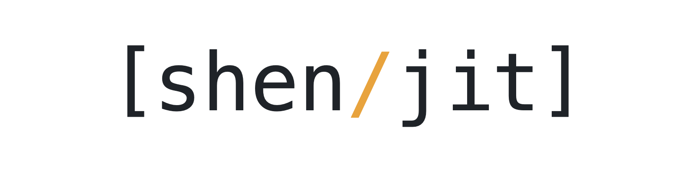

<picture>
  <source media="(prefers-color-scheme: dark)" srcset="assets/shen-jit-logo-dark.png">
  
</picture>

# Shen/JIT

A small implementation of [Shen](https://shenlanguage.org) that compiles every function to native code, through a
register bytecode and a baseline JIT built on [SLJIT](https://github.com/zherczeg/sljit). The lowerer is written in
Shen and compiles itself. The runtime is about 8,000 lines of C, and the lowerer and the port add about 1,200 lines
of Shen, not counting comments and blank lines.

It passes the kernel's test suite, the extension tests and the contract examples, on macOS on arm64, on Linux on
x86-64 and arm64, and on Windows on x86-64.

**[The guide](https://tizoc.github.io/shen-jit/)** covers installing, using and building it. Its source is
[docs/guide.md](docs/guide.md), and release archives carry it rendered.

Executables are on the [releases](https://github.com/tizoc/shen-jit/releases) page. From a checkout:

```sh
make deps
make
build/shen-jit
```

[docs/](docs/) has how it works, [AGENTS.md](AGENTS.md) how to work on it, and [CHANGELOG.md](CHANGELOG.md) what each
release changed.

## License

Shen/JIT is under the BSD 3-clause license: see [LICENSE](LICENSE). The port and some tests hold definitions from the
Shen kernel, whose licence is in [LICENSE-shen-kernel.txt](LICENSE-shen-kernel.txt), and so does the executable, with
SLJIT and xxHash, each in `vendor/` with its license and an `UPSTREAM.md` naming the imported revision.
